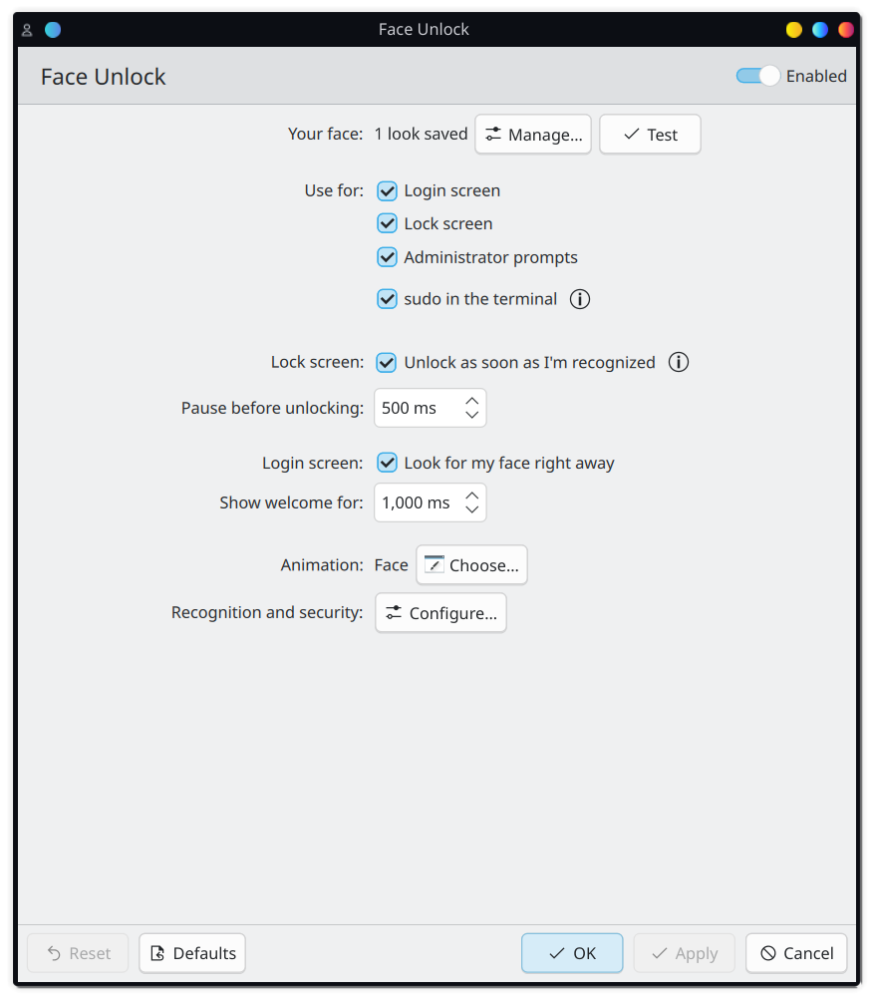
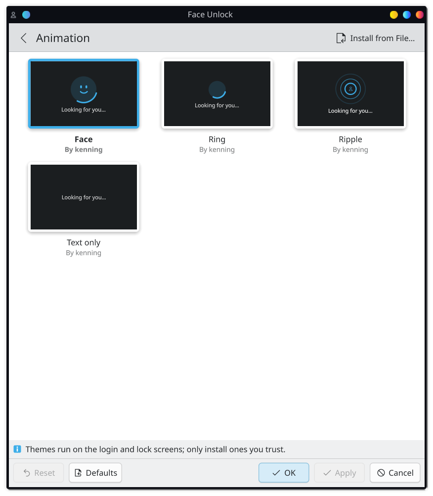
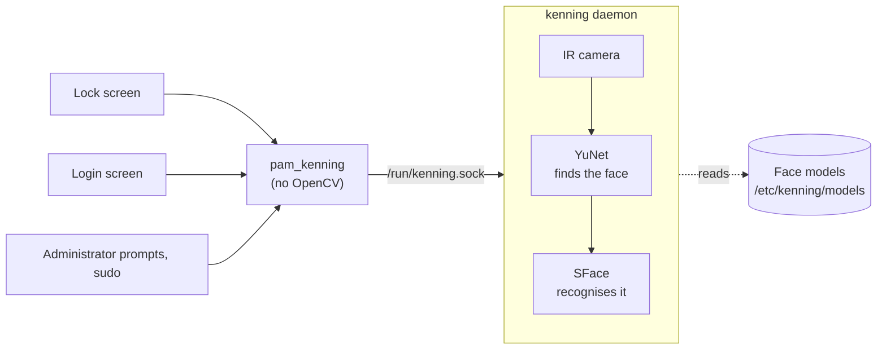
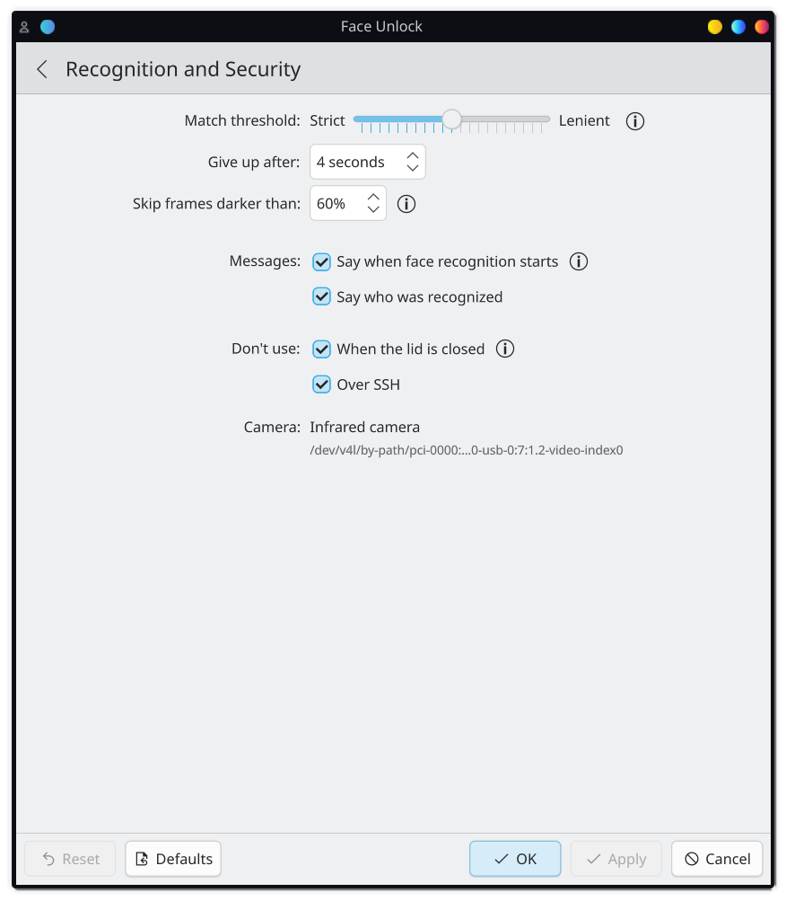

<div align="center">

<picture>
  <source media="(prefers-color-scheme: dark)" srcset="docs/images/banner-dark.svg">
  
</picture>

Sign in, unlock and approve with your face, on the login screen, the lock screen and in System Settings.<br>
<sub>To <i>ken</i> someone is to know or recognise them.</sub>

[](https://github.com/RishonDev/kenning/releases/latest)
[](https://github.com/RishonDev/kenning/actions/workflows/lockscreen.yml)
[](#plasma-versions)
[](LICENSES/GPL-2.0-or-later.txt)

[](https://github.com/RishonDev/kenning/releases/latest)
[](https://launchpad.net/~mithicalaviator85/+archive/ubuntu/kenning)
[](https://github.com/RishonDev/kenning/issues/new)

<br>

<picture>
  <source media="(prefers-color-scheme: dark)" srcset="docs/images/settings-dark.png">
  
</picture>

</div>

## Features

| | |
|---|---|
| **Everywhere you sign in** | The lock screen, the login screen, administrator prompts and `sudo`. Your password always works too. |
| **Plasma's own lock screen** | On Plasma 6.8, Kenning provides the Face sign-in method that Plasma already has a place for. It falls back to your fingerprint or password, and switches to the password as soon as you type. |
| **Guided setup** | Look straight at the camera, then turn your head when asked, with the steps read aloud if you like. Add more looks for glasses on or off, or different lighting. |
| **Infrared first** | Uses the IR camera of laptops made for face sign-in. An ordinary webcam works too, with a clear warning about what that means. |
| **Animated scan** | A face scan animation on the login and lock screens, with installable themes. |
| **Private by design** | Face models stay on your computer, readable only by Kenning's service, which answers only for your own account. |

## Install

<details open>
<summary><b>Ubuntu 26.04 and 26.10</b></summary>

```sh
sudo add-apt-repository ppa:mithicalaviator85/kenning
sudo apt install kenning
```
</details>

<details>
<summary><b>Debian 13</b></summary>

Download `kenning_<version>_debian13_<amd64|arm64>.deb` from the [latest release](https://github.com/RishonDev/kenning/releases/latest), then:

```sh
sudo apt install ./kenning_*_debian13_amd64.deb
```
</details>

<details>
<summary><b>Fedora 44</b></summary>

Download `kenning-<version>.fc44.<x86_64|aarch64>.rpm` from the [latest release](https://github.com/RishonDev/kenning/releases/latest), then:

```sh
sudo dnf install ./kenning-*.fc44.x86_64.rpm
```
</details>

<details>
<summary><b>Arch Linux</b></summary>

Download `kenning-<version>-x86_64.pkg.tar.zst` from the [latest release](https://github.com/RishonDev/kenning/releases/latest), and for face unlock on the login screen, `plasma-login-manager-kenning` too, then:

```sh
sudo pacman -U kenning-*.pkg.tar.zst plasma-login-manager-kenning-*.pkg.tar.zst
```
</details>

Then open **System Settings › Security & Privacy › Face Unlock** and press **Set Up…**. The camera is found automatically, and once your face is saved, face unlock is switched on for the login screen, the lock screen and `sudo`.

To have the setup steps read aloud, install `speech-dispatcher` with a voice such as `espeak-ng`.

## Animation themes

Pick how the scan looks on the login and lock screens, or install a theme from a file. Themes are QML, like SDDM themes; [THEMES.md](THEMES.md) shows how to make one.

<div align="center">
<picture>
  <source media="(prefers-color-scheme: dark)" srcset="docs/images/animation-dark.png">
  
</picture>
</div>

## How it works



- **One service owns the camera and the face models**, like fprintd does for fingerprints. systemd starts it on demand, it runs as its own user, and it only answers for root or for the account being checked. The models are readable by nothing else.
- **Nothing heavy runs inside sign-in.** `pam_kenning` only asks the service, so OpenCV never loads into the lock screen, the login manager or `sudo`.
- **Safeguards** limit what a face can do:
  - after five faces that weren't yours in 15 minutes, face unlock pauses for 10 minutes, like `pam_faillock`
  - Kenning's lock screen service fails closed
  - face unlock stays off over SSH and with the lid closed
  - an ordinary webcam is never used to approve system changes unless you choose it

<details>
<summary><b>Recognition and security settings</b></summary>
<br>
<div align="center">
<picture>
  <source media="(prefers-color-scheme: dark)" srcset="docs/images/advanced-dark.png">
  
</picture>
</div>
</details>

### Plasma versions

| Plasma | Lock screen |
|---|---|
| 6.8 and newer | Plasma's own Face sign-in method (PAM service `kde-face`, which Kenning provides) with the scan animation |
| 6.3 to 6.7 | Face unlock before the password check, with the scan animation, unlocking without pressing Unlock |
| Older, or unknown | The stock lock screen; look at the camera, then press Unlock |

Face unlock on the login screen needs `plasma-login-manager-kenning`, packaged for Arch Linux so far.

## Building

Everything comes from your distribution's repositories (OpenCV, Qt, KDE Frameworks), plus the two recognition networks from the [OpenCV Zoo](https://github.com/opencv/opencv_zoo): YuNet (`face_detection_yunet_2023mar.onnx`) and SFace (`face_recognition_sface_2021dec.onnx`). `makepkg` downloads them; elsewhere, put them in the repository root first.

| Distribution | Build |
|---|---|
| Arch Linux | `makepkg -si`, which also builds `plasma-login-manager-kenning` |
| Debian, Ubuntu | `cp -r packaging/debian debian && dpkg-buildpackage -b -uc -us -jauto` |
| Fedora | `rpmbuild -bb packaging/rpm/kenning.spec` |

All three share one CMake install, and `tests/containers/` builds and tests them in containers.

<details>
<summary><b>Repository layout</b></summary>

| Folder | What's in it |
|---|---|
| `engine/native/` | The `kenning` command (enrol, list, remove, test), the service (`kenning daemon`) and `pam_kenning.so` |
| `kcm/` | The System Settings page, its KAuth helper and the bundled themes |
| `lockscreen/` | The lock screen add-on, re-applied after Plasma updates and undone on removal |
| `login-manager/` | The patch for Plasma Login Manager: scans as soon as the login screen appears |
| `packaging/` | Arch, Debian and Fedora packaging, PAM tidying, and the first-login setup prompt |
| `tests/containers/` | Package and lock screen tests in distribution containers |

</details>

## Coming from Howdy

Kenning began on [Howdy](https://github.com/boltgolt/howdy) and keeps its config keys, model file layout, exit codes and PAM messages. Its engine is native C++ instead of Python and dlib, so faces enrolled with Howdy need to be enrolled again. The `archive/howdy-bundled` branch keeps an older version that uses Howdy's engine. More is planned in the [roadmap](ROADMAP.md).

## Credits

- **[Howdy](https://github.com/boltgolt/howdy)** by boltgolt and its contributors (MIT). Kenning started on Howdy, follows its conventions so the two stay familiar to each other's users, and takes many of its safeguards (dark frame skipping, lid and SSH checks) from Howdy's design.
- **[OpenCV](https://opencv.org)** and the **[OpenCV Zoo](https://github.com/opencv/opencv_zoo)** networks: YuNet face detection (Shiqi Yu and colleagues, MIT) and SFace face recognition (Zhong, Deng and colleagues, Apache-2.0).
- **KDE** and the Plasma developers, whose lock screen, login manager and System Settings Kenning builds on.
- Developed by **Rishon Jonathan R**, with help from **Claude** (Anthropic) as a coding assistant.

## License

GPL-2.0-or-later, with some files under LGPL-2.0-or-later or CC0-1.0; each file says which, following [REUSE](https://reuse.software).
